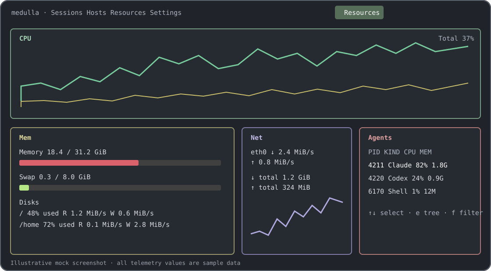
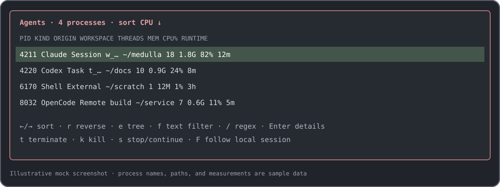

# Resources

The Resources tab shows a live snapshot of this machine's CPU, memory and swap,
disks, network interfaces, and discovered agent processes, on this machine and
on each connected remote host. Sampling runs in the background at the
configured interval while the tab is on screen, and pauses on every other tab. Press `?` on the tab for the short key-help overlay,
or `o` to open Settings › Resources.



## The panels

| Panel | What it shows |
| --- | --- |
| **CPU** | A full-height usage history beside a per-core box: an overall meter, each core's history, usage and temperature where reported, the CPU model and frequency on its border, and the load average. When the box is too small for it, the cores become text rows under the graph. A lower field the platform never reports, such as iowait on macOS, gives its half of the graph to the upper field. |
| **Mem** | Total, used, available, cached, and free memory, each with its percentage and a history graph (or a meter with `memGraphs = false`), and swap. Beside a divider, every local volume as btop lists it, each under a divider headed by its name and size, with swap second: an IO row where the column has room and the volume has IO counters, then its used meter. On macOS this includes the system volumes (VM, Preboot, Update, and the rest) that Finder hides. Disk filtering and graph ceilings can be configured in `[resources]`. |
| **Net** | Download history growing up and upload history growing down, each on its own scale, beside a box of current, peak, and total traffic each way. Automatic scaling, shared scales, interface cycling, and resetting displayed totals are available. The interface chosen by default is the first active one with a routable address. |
| **Agents** | Recognized agent processes and supported shells, their ownership/origin, workspace, CPU and memory use, thread count, runtime, and recent CPU history. Tree mode can show descendants. |

Each panel is a rounded box in the btop style. Its borders carry its
controls as tags, `┐¹cpu┌┐menu┌`, with the hotkey letter highlighted; every
tag can be clicked as well as pressed. A dimmed tag is a toggle that is off.

The layout adapts to terminal size. If all panels do not fit, Medulla hides
lower-priority panels as whole boxes and shows a hint; at very small sizes it
shows the minimum required size. The `cpuBottom`, `memBelowNet`, and
`agentsLeft` settings can override placement selected by the active preset.

## Agents pane

Each row is one harness: a process whose program is a known harness, named
by its executable, by the name it was launched as (Claude's native build runs
from a versioned file such as `versions/2.1.310`), or, under an interpreter
such as `node` or `python3`, by the script it runs. A path or argument that
merely mentions a harness does not count, so an editor installed under
`Cursor.app` or an MCP server is not listed. Current kinds are Claude, Codex,
Codex Server, Claude-ACP, Codex-ACP, OpenCode, OpenCode-ACP, OpenHuman (core
and embedded), Gemini, Aider, Goose, Cursor Agent, and supported shells.
`Unknown` is used when argv is unavailable for a program the classifier
supports. A session Medulla launched stays listed even when its program is not
one of these.

A harness that re-runs itself, such as Codex's app-server daemon and the
server it supervises, is one row. Each row's threads, memory, and CPU are
the whole process tree's; tree mode lists the descendants beneath it.

Origins explain which Medulla activity owns a process: `Session{id}`,
`Task{id}`, `Headless`, `Remote{host}`, or `External`. Remote session usage is
optional telemetry supplied by that host; missing usage is shown as
unavailable. The pane does not send signals to remote processes.

| Key | Action |
| --- | --- |
| `↑` / `↓`, `PgUp` / `PgDn`, `Home` / `End` | Move through agent rows. |
| `←` / `→` | Change the sort field: PID, kind, origin, workspace, threads, memory, CPU, or runtime. |
| `r` | Reverse the current sort. |
| `e` | Toggle process-tree display. |
| `f` / `/` | Open the filter editor. Text is matched literally by default; a query beginning with `!` is interpreted as a case-insensitive regular expression against agent kind. An invalid regular expression matches no rows. |
| `Enter` | Focus the owning Medulla session, local or remote, or open details for a row without a session. |
| `F` | Follow the selected local agent. Remote rows cannot be followed. |
| `t`, `k`, `s` | Request terminate, kill, or stop/continue on supported local processes. Medulla asks for confirmation; external processes require a second confirmation. Signals are unavailable on Windows and are never sent to remote processes. |
| `Esc` | Close the active detail, filter, or confirmation overlay. |

Process signals are restricted to supported Unix systems and processes owned
by the current user. The prompt names the target before a signal is sent.



## Resources keys

These keys apply on the Resources tab. The `?` overlay lists the panel and
network controls.

| Key | Action |
| --- | --- |
| `1`–`4` | Show or hide CPU, Mem, Net, or Agents, respectively. |
| `p` / `P` | Previous / next layout preset. |
| `+` / `-` | Increase / decrease sample interval by 100 ms, bounded to 100–10,000 ms. `=` also increases it. |
| `d` | Show or hide disks in Mem. |
| `i` | Toggle disk activity display. |
| `a` | Toggle network automatic scaling. |
| `y` | Toggle a shared network scale for download and upload. |
| `b` / `n` | Select the previous / next available network interface. |
| `z` | Reset the displayed network totals for the selected interface. |
| `o` | Open Settings › Resources. |
| `m` | Toggle the menu. |
| `?` | Toggle key help. |
| `Esc` | Close the menu or help. |

## Layout presets

`presets` is a whitespace-separated list. Within each preset, commas separate
box entries in the form `<box>:<position>:<graph>`. Box names are `cpu`,
`mem`, `net`, and `agents`; position is `0` or `1`; the required graph token is
validated as `default`, `braille`, `block`, or `tty`. Presets currently apply
box visibility and placement only; the graph token is ignored. For example:

```toml
[resources]
presets = "cpu:0:default,mem:0:default,net:0:default,agents:1:braille cpu:0:block,agents:0:tty"
preset = 0
```

Preset 0 is the default all-panel layout. Up to nine additional presets are
accepted. Malformed presets are ignored; if none remain, the default is used.
`shownBoxes` controls which panels are initially visible. Choosing a preset
interactively applies the boxes and placement encoded in that preset.

## Configuration reference

Configuration keys are camelCase. Omitted values use the defaults below.
`updateMs` is clamped to 100–10,000 milliseconds. Enum-like strings with
unrecognized values fall back to the default behavior.

### `[resources]`

| Key | Type | Default | Meaning |
| --- | --- | --- | --- |
| `updateMs` | integer | `2000` | Background sampling interval in milliseconds; clamped to `100..=10000`. |
| `shownBoxes` | string | `"cpu,mem,net,agents"` | Comma-separated visible panels at startup. |
| `presets` | string | `"cpu:0:default,mem:0:default,net:0:default,agents:1:default"` | Whitespace-separated layout presets. |
| `preset` | integer | `0` | Selected preset index. |
| `cpuBottom` | boolean or omitted | omitted | Override the selected preset's CPU placement. |
| `memBelowNet` | boolean or omitted | omitted | Override the selected preset's Mem/Net placement. |
| `agentsLeft` | boolean or omitted | omitted | Override the selected preset's Agents placement. |
| `cpuGraphUpper` | string | `"total"` | CPU field shown by the upper graph. |
| `cpuGraphLower` | string | `"iowait"` | CPU field shown by the lower graph. |
| `cpuInvertLower` | boolean | `false` | Invert the lower CPU graph. |
| `cpuSingleGraph` | boolean | `false` | Combine CPU fields into one graph. |
| `tempScale` | string | `"celsius"` | Temperature unit: `celsius` or `fahrenheit`. |
| `freqMode` | string | `"auto"` | Frequency display: `auto`, `mhz`, or `ghz`. |
| `showBattery` | boolean | `true` | Show battery percentage when reported by the platform. |
| `memGraphs` | boolean | `true` | Show memory and swap history graphs. |
| `showDisks` | boolean | `true` | Show mounted disks in Mem. |
| `showSwap` | boolean | `true` | Show swap usage in Mem. |
| `swapDisk` | boolean | `true` | Include a swap device as a disk row when available. |
| `onlyPhysical` | boolean | `true` | Hide virtual and loop devices from the disk list. |
| `useFstab` | boolean | `true` | Prefer filesystems listed in `/etc/fstab`. |
| `disksFilter` | string | `""` | Comma-separated mount filters; prefix an entry with `exclude=` to omit it. |
| `ioMode` | boolean | `false` | Show disk busy/activity data in the disk pane. |
| `ioGraphCombined` | boolean | `false` | Combine disk read and write series into one graph. |
| `ioGraphSpeeds` | string | `""` | Per-mount graph ceilings as comma-separated `mount:speed` pairs, with speed in MiB/s. |
| `netAuto` | boolean | `true` | Automatically scale network graphs to recent traffic. |
| `netSync` | boolean | `false` | Use one shared scale for download and upload graphs. |
| `netDownload` | integer | `100` | Download graph ceiling in KiB/s when automatic scaling is off. |
| `netUpload` | integer | `100` | Upload graph ceiling in KiB/s when automatic scaling is off. |
| `netIface` | string or omitted | omitted | Preferred interface name; omitted or `"auto"` chooses automatically. |
| `swapUploadDownload` | boolean | `false` | Swap the displayed download and upload directions. |

### `[theme.resources]`

Each value accepts a named Ratatui color or `#rrggbb`. Invalid colors use the
built-in default. For each gradient, `Start` sets its first stop, `Mid` the
middle stop, and `End` the last stop. An empty `Mid` interpolates directly
between start and end; an empty `End` produces a solid start color.

| Key(s) | Type | Default |
| --- | --- | --- |
| `cpuBox` | color | `#556d59` |
| `memBox` | color | `#6c6c4b` |
| `netBox` | color | `#5c588d` |
| `procBox` | color | `#805252` |
| `divLine` | color | `#303030` |
| `meterBg` | color | `#404040` |
| `graphText` | color | `#606060` |
| `inactiveFg` | color | `#404040` |
| `mainFg` | color | `#cccccc` |
| `mainBg` | color, or `""` for the terminal's own | the app-wide `[theme] background` (`#000000`) |
| `title` | color | `#eeeeee` |
| `hiFg` | color | `#b54040` |
| `selectedBg` | color | `#6a2f2f` |
| `selectedFg` | color | `#eeeeee` |
| `cpuStart`, `cpuMid`, `cpuEnd` | colors | `#77ca9b`, `#cbc06c`, `#dc4c4c` |
| `tempStart`, `tempMid`, `tempEnd` | colors | `#4897d4`, `#5474e8`, `#ff40b6` |
| `usedStart`, `usedMid`, `usedEnd` | colors | `#592b26`, `#d9626d`, `#ff4769` |
| `freeStart`, `freeMid`, `freeEnd` | colors | `#384f21`, `#b5e685`, `#dcff85` |
| `cachedStart`, `cachedMid`, `cachedEnd` | colors | `#163350`, `#74e6fc`, `#26c5ff` |
| `availableStart`, `availableMid`, `availableEnd` | colors | `#4e3f0e`, `#ffd77a`, `#ffb814` |
| `downloadStart`, `downloadMid`, `downloadEnd` | colors | `#291f75`, `#4f43a3`, `#b0a9de` |
| `uploadStart`, `uploadMid`, `uploadEnd` | colors | `#620665`, `#7d4180`, `#dcafde` |
| `processStart`, `processMid`, `processEnd` | colors | `#80d0a3`, `#dcd179`, `#d45454` |

For example:

```toml
[theme.resources]
cpuBox = "#556d59"
cpuStart = "#77ca9b"
cpuMid = "#cbc06c"
cpuEnd = "#dc4c4c"
```

## Platform differences

Telemetry depends on what the operating system exposes. CPU field breakdowns,
hardware temperatures, disk IO rates, per-interface addresses, process argv,
and process IO counters may be unavailable on some platforms or systems. In
that case, Medulla omits the field or displays it as unavailable; it does not
infer a value. Disk IO sources are platform-dependent, and some detailed disk
measurements are currently Linux-specific. Windows does not support process
signal actions. Remote hosts report only optional classified session usage,
not host-wide resource totals or arbitrary external processes.

For the wire shape of remote session usage, see the [Host Link Protocol](../developers/host-link-protocol.md#optional-session-process-usage).
